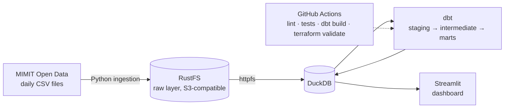
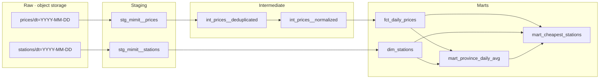
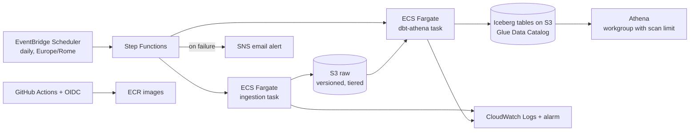

# ⛽ Italy Fuel Prices Pipeline

**A daily ELT pipeline that answers a simple question: _where is fuel cheapest in Italy today?_**
Built locally with Docker and open-source tools, designed for production on AWS with Terraform.

[](https://github.com/<your-username>/italy-fuel-prices-pipeline/actions/workflows/ingestion.yml)
[](https://github.com/<your-username>/italy-fuel-prices-pipeline/actions/workflows/dbt.yml)
[](https://github.com/<your-username>/italy-fuel-prices-pipeline/actions/workflows/terraform.yml)
[](LICENSE)
[](<video-link>)

> 🎥 This project is part of **A Date with Data**, a YouTube series where I build real data engineering projects end to end. The full walkthrough (in Italian) is [here](<video-link>).

<!-- Add a screenshot once the dashboard runs:  -->

---

## Table of contents

- [The problem](#the-problem)
- [Architecture](#architecture)
- [Tech stack](#tech-stack)
- [Quick start](#quick-start)
- [The data](#the-data)
- [Data model](#data-model)
- [Data quality](#data-quality)
- [Key design decisions](#key-design-decisions)
- [Production architecture on AWS](#production-architecture-on-aws)
- [Project structure](#project-structure)
- [What I learned](#what-i-learned)
- [Roadmap](#roadmap)
- [Data source and license](#data-source-and-license)

---

## The problem

Every day, Italian fuel stations report their prices to the Ministry of Enterprises and Made in Italy (MIMIT), which publishes them as open data. The data is rich, but raw: thousands of stations, dozens of brand-specific fuel labels, different units of measure and a file format that changes without notice.

This project turns those raw files into a clean, tested analytical model and a dashboard that shows:

- the **cheapest stations** by province and fuel type;
- the **average, minimum and maximum price** by province;
- how each station compares to the **local average**;
- how prices **change over time**.

Who would use it: drivers, companies managing vehicle fleets, journalists analysing price trends.

## Architecture



1. **Ingestion:** a Python job downloads the daily files, checks their format and stores them unchanged in an S3-compatible data lake, partitioned by reference date.
2. **Transformation:** dbt reads the raw files through DuckDB, cleans and models them into staging, intermediate and mart layers, and tests every step.
3. **Serving:** a Streamlit dashboard queries the marts.
4. **CI:** three independent GitHub Actions workflows, each triggered only when its part of the repository changes: Python lint and tests, a full dbt build on sample data, Terraform format and validation.

## Tech stack

| Layer | Tool | Why |
|---|---|---|
| Ingestion | Python, `requests`, `boto3` | Simple, readable, easy to test |
| Data lake | [RustFS](https://github.com/rustfs/rustfs) | S3-compatible: the same code runs on AWS by changing one endpoint |
| Query engine | DuckDB | Fast analytical engine with no server; reads directly from S3 |
| Transformation | dbt Core (`dbt-duckdb`) | Version-controlled, tested and documented SQL |
| Dashboard | Streamlit | A data app in pure Python |
| Containers | Docker Compose | The whole stack starts with one command |
| CI | GitHub Actions | Lint, unit tests, dbt build, Terraform validate |
| Infrastructure as Code | Terraform | Production infrastructure on AWS |

> **Why RustFS and not MinIO?** MinIO stopped publishing community Docker images in late 2025, so `docker pull minio/minio` no longer works. RustFS is an Apache-2.0, S3-compatible alternative. Tools disappear: designing against the S3 API, not a specific product, is what makes the swap a one-line change.

**Keywords:** `Python` `SQL` `ELT` `dbt` `DuckDB` `S3` `Docker` `GitHub Actions` `Terraform` `AWS` `ECS Fargate` `Step Functions` `Athena` `Apache Iceberg` `IAM` `OIDC` `data quality` `dimensional modeling`

## Quick start

**Requirements:** Docker Desktop (8 GB RAM recommended) and `make`.

<details>
<summary>On Windows</summary>

Install make with `winget install ezwinports.make`, then run the commands from **Git Bash**. Or run the `docker compose` commands in the [Makefile](Makefile) directly.
</details>

```bash
git clone https://github.com/<your-username>/italy-fuel-prices-pipeline.git
cd italy-fuel-prices-pipeline
cp .env.example .env      # then paste the two MIMIT file URLs into .env
make up                   # starts the storage and the dashboard
make pipeline             # downloads the latest data and runs dbt
```

Then open:

| Service | URL |
|---|---|
| Dashboard | http://localhost:8501 |
| RustFS console | http://localhost:9001 (credentials from `.env`) |
| dbt docs | `make docs` → http://localhost:8080 |

Other commands (`make help` lists them all):

```bash
make ingest      # ingestion only
make transform   # dbt build only
make dbt-ci      # dbt build on the sample files, no download needed
make test        # Python unit tests
make down        # stop everything
make clean       # stop everything and delete the data
```

## The data

| | |
|---|---|
| **Source** | MIMIT – "Carburanti – Prezzi praticati e anagrafica degli impianti" |
| **Files** | `prezzo_alle_8.csv` (prices), `anagrafica_impianti_attivi.csv` (station registry) |
| **Frequency** | Daily |
| **Format** | CSV, pipe-separated (`|`) since 10 February 2026 |
| **License** | IODL 2.0 |

Three details that shape the whole pipeline:

- **Publication date ≠ reference date.** Each file contains the prices in force at 8:00 AM on the day *before* publication. The ingestion reads the date written in the file ("Estrazione del …") and uses it as the partition, so `price_date` is always the day the price was valid, whatever day the job runs.
- **Not every price is per litre.** Prices are per litre, except methane (and LNG), which are per kilogram. The model carries a `unit` column, and averages never mix units.
- **Fuel labels are messy.** Besides standard fuels (petrol, diesel, LPG, methane), premium fuels are named after each brand's product. Rules map them to standard categories, a seed fixes exceptions, and a test warns when unknown labels appear.

## Data model



| Model | Grain | Description |
|---|---|---|
| `stg_mimit__prices` | one row per raw price record | Typed, renamed columns |
| `stg_mimit__stations` | one row per station per day | Cleaned registry with coordinates |
| `int_prices__deduplicated` | station × fuel label × service mode × day | Keeps the most recently communicated price |
| `int_prices__normalized` | same | Adds fuel category, unit and premium flag |
| `dim_stations` | one row per station | Province, municipality, brand, coordinates |
| `fct_daily_prices` | station × fuel label × service mode × day | The core fact table |
| `mart_province_daily_avg` | day × province × fuel × service mode | Average, min, max, number of stations (standard fuels) |
| `mart_cheapest_stations` | day × province × fuel × service mode (top 10) | Cheapest stations and their gap from the average |

<!-- Add the lineage graph from `make docs`:  -->

## Data quality

Quality is checked at two points: when the file arrives, and when it is modelled.

| Where | Check | What it catches |
|---|---|---|
| Ingestion | Separator, header and required columns | The source changed its format |
| Ingestion | Empty file / no rows | A broken download |
| Ingestion | All files validated before any write | Half-written days |
| dbt | `unique` + `not_null` on keys | Duplicates and broken keys |
| dbt | `relationships` prices → stations | Prices for unknown stations |
| dbt | `accepted_values` on category and unit | Unexpected values |
| dbt | Price between 0.30 and 5.00 €/unit | Reporting errors (0 €, 19.99 €) |
| dbt | Freshness: latest data ≤ 3 days old | The daily file did not arrive |
| dbt | Share of unmapped fuel labels ≤ 5% (warning) | New brand-specific labels |

A failing test stops `dbt build` before bad data reaches the marts.

## Key design decisions

| Decision | Why | Trade-off |
|---|---|---|
| **Raw files stored unchanged** | A parsing bug can be fixed and replayed without downloading again | More storage (negligible here) |
| **Idempotent ingestion** (one partition per reference date, overwritten on rerun) | Reruns never create duplicates | Only the latest copy of a day's file is kept (versioning is on in S3) |
| **Partition by the date in the file, not the run date** | Late or repeated runs land in the right day | Relies on the "Estrazione del" line (with a fallback) |
| **Parsing in dbt, not in Python** | Business logic in one place, tested and documented | SQL must handle a slightly messy CSV |
| **DuckDB instead of PostgreSQL** | Analytical workload, no server, reads S3 directly | Single writer: fine for batch, not for concurrent apps |
| **S3 API everywhere** | Same code locally (RustFS) and on AWS (S3) | One more container locally |
| **One repository (monorepo), independent components** | Ingestion and dbt share a contract (the raw file layout) and test fixtures: changing both in one commit, tested together, prevents silent breakage. Each component still has its own folder, dependencies, Docker image and CI workflow, so it can move to its own repository with no code changes | In a company, separate teams or release cycles may justify separate repositories; path-filtered workflows also mean a "required check" setup on GitHub needs care, since skipped workflows do not report a status |

## Production architecture on AWS

The Terraform code in [`infra/aws`](infra/aws) describes the production version of this pipeline.



| Local | AWS | Why it changes |
|---|---|---|
| `make pipeline` | EventBridge Scheduler + Step Functions | Scheduling, retries with backoff, run history |
| Python container | Same image on ECR, run on ECS Fargate | No servers; identical code locally and in the cloud |
| RustFS | S3: encrypted, private, versioned, lifecycle to cheaper tiers | Durability and low storage cost |
| DuckDB | Athena + Apache Iceberg + Glue Data Catalog | Serverless, pay per query, open table format |
| `.env` credentials | One IAM role per task, least privilege | No credentials in code |
| Container logs | CloudWatch Logs, alarm, SNS email | Failures are noticed immediately |
| Docker Compose | Terraform | Reproducible, reviewable infrastructure |
| — | GitHub Actions with OIDC | Pushing images without long-lived AWS keys |
| — | AWS Budgets | Email alert at 80% of the monthly budget |

**Production concerns addressed in the Terraform:**
- **Reliability:** Step Functions retries each task twice with backoff; any failure sends an email; a CloudWatch alarm is a second safety net.
- **Security:** private encrypted buckets with public access blocked; separate IAM roles for ingestion (write raw only) and dbt; GitHub can only push images, and only from this repository.
- **Cost:** serverless, pay-per-use services; Athena workgroup with a per-query scan limit; raw files move to cheaper storage after 30 and 180 days; query results expire after 7 days; monthly budget alert.
- **Networking trade-off:** tasks run in the default VPC with a public IP to avoid NAT gateway costs. In a company setup they would run in private subnets with VPC endpoints.

**What is left to do for a real deployment:**
- port the two staging models to Athena (raw CSV registered as external tables instead of DuckDB's `read_csv`, `date_parse` instead of `strptime`, `row_number()` in a subquery instead of `QUALIFY`) and enable the `prod` target in `transform/profiles.yml`;
- add a workflow that builds and pushes the images to ECR using the `github_actions_role_arn` output.

```bash
cd infra/aws
cp terraform.tfvars.example terraform.tfvars   # fill in your values
terraform init
terraform plan
```

<details>
<summary>Equivalent services on GCP and Azure</summary>

| | GCP | Azure |
|---|---|---|
| Scheduling and orchestration | Cloud Scheduler + Workflows | Data Factory / Fabric pipelines |
| Compute | Cloud Run Jobs | Container Apps Jobs |
| Storage | Cloud Storage | ADLS Gen2 / OneLake |
| Query engine | BigQuery (BigLake for Iceberg) | Fabric Warehouse / Databricks SQL |
| dbt adapter | `dbt-bigquery` | `dbt-fabric` / `dbt-databricks` |
| BI | Looker Studio | Power BI |

</details>

## Project structure

```
italy-fuel-prices-pipeline/
├── .github/workflows/
│   ├── ingestion.yml               # Python lint and tests      (on changes to ingestion/)
│   ├── dbt.yml                     # dbt build on fixtures      (on changes to transform/ or fixtures)
│   └── terraform.yml               # terraform fmt and validate (on changes to infra/)
├── ingestion/
│   ├── src/ingestion/              # config, validation, download and upload
│   ├── tests/                      # unit tests + sample raw files (fixtures)
│   ├── Dockerfile
│   └── pyproject.toml
├── transform/                      # dbt project
│   ├── models/{staging,intermediate,marts}/
│   ├── macros/                     # CSV reader, custom generic tests
│   ├── seeds/                      # fuel label overrides
│   ├── tests/                      # freshness and unmapped-label checks
│   └── Dockerfile
├── dashboard/                      # Streamlit app
├── infra/aws/                      # Terraform for the production architecture
├── docs/                           # screenshots and diagrams
├── docker-compose.yml
├── Makefile
└── .env.example
```

## Data source and license

- **Data:** MIMIT – Ministero delle Imprese e del Made in Italy, "Carburanti – Prezzi praticati e anagrafica degli impianti", released under the Italian Open Data License 2.0 (IODL 2.0).
- **Code:** [MIT License](LICENSE).

---

**Author:** Antonio Mangione, Senior Data Engineer · [LinkedIn](https://www.linkedin.com/in/antonio-mangione-48806a154) · [YouTube: A Date with Data](https://www.youtube.com/@<your-handle>)
